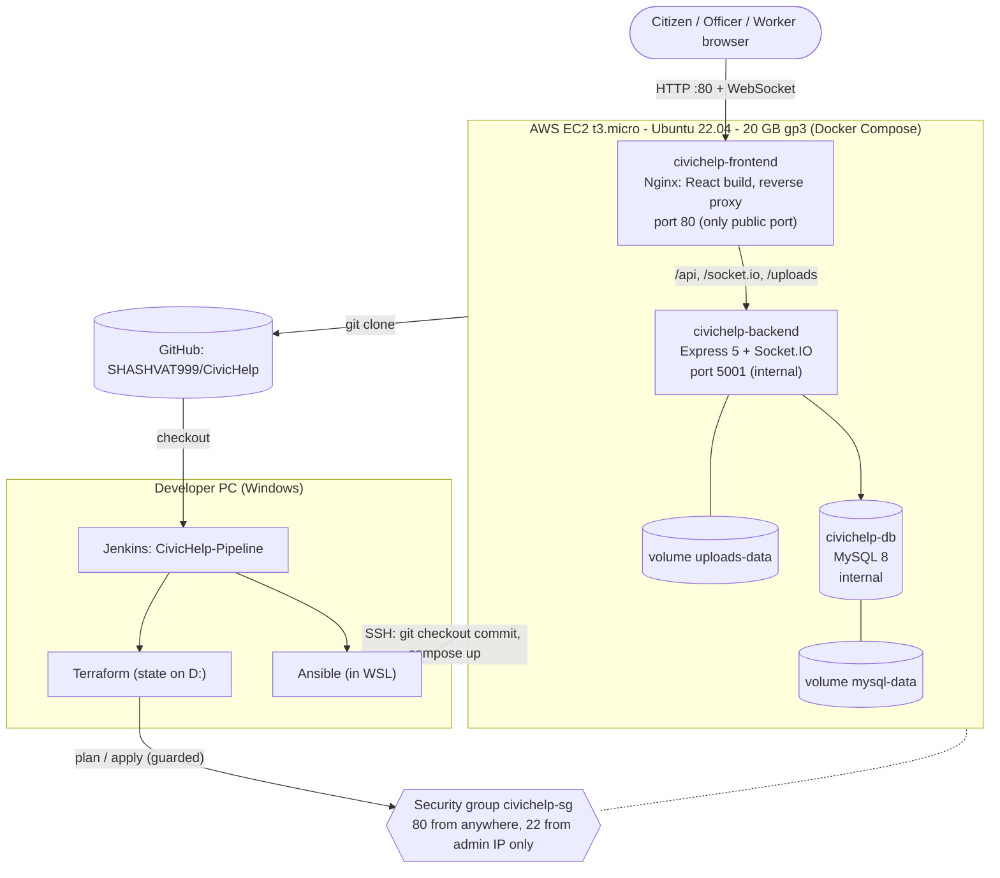

# CivicHelp

CivicHelp is a civic issue reporting platform. Citizens report local problems such as potholes, broken streetlights,
garbage dumps and open drains, with a map location and a photo. Ward officers assign field workers, workers upload a
photo of the completed repair, and the citizen confirms the fix or reopens the report. Every change appears live on the
public map and the dashboards.

The project also covers the full DevOps lifecycle:
- Docker containers;
- infrastructure as code with Terraform;
- configuration management with Ansible;
- one Jenkins CI/CD pipeline that tests every commit and deploys it to AWS EC2.

| Document | For |
|---|---|
| [`docs/CI_CD_PIPELINE.md`](docs/CI_CD_PIPELINE.md) | Every Jenkins stage explained, design decisions, likely questions |
| [`docs/START_STOP_AND_PRESENTATION_GUIDE.md`](docs/START_STOP_AND_PRESENTATION_GUIDE.md) | Day-to-day commands: start/stop AWS, Jenkins, demo script, troubleshooting |
| [`docs/PRESENTATION.md`](docs/PRESENTATION.md) | Short presentation walkthrough |

---

## Features

- **Reporting:** category, description, a map pin (click on the map, address search through OpenStreetMap Nominatim, or GPS) and an optional photo.
- **Public live map:** colour-coded status markers, status and category filters, grouping of overlapping reports.
- **Ward officer dashboard:** every report, assignment to field workers, before and after photos, citizen feedback.
- **Field worker dashboard:** only their own tasks. Resolving requires an "after" photo.
- **Citizen verification:** the reporter confirms the fix or reopens it with a reason.
- **Real-time updates:** Socket.IO pushes new reports and status changes to the map and the dashboards.
- **Optional e-mail:** the citizen is notified on resolution when SMTP credentials are configured.

## Architecture



| Layer | Technology |
|---|---|
| Frontend | React 19, React Router 7, Leaflet / React-Leaflet, Axios, Socket.IO client, Lucide icons |
| Backend | Node.js 24, Express 5, Socket.IO 4, Multer, Nodemailer, bcryptjs, jsonwebtoken, mysql2 |
| Database | MySQL 8.0, schema in [`init.sql`](init.sql), changes in [`migrations/`](migrations) |
| Containers | Docker, Docker Compose, Nginx (Alpine) |
| Infrastructure | Terraform: EC2 instance, security group, key pair ([`terraform/`](terraform)) |
| Configuration | Ansible: Docker, swap, checkout, `.env`, Compose, health checks ([`ansible/`](ansible)) |
| CI/CD | Jenkins declarative pipeline ([`Jenkinsfile`](Jenkinsfile)) |
| Tests | `node:test` unit tests ([`backend/tests/`](backend/tests)), workflow integration test ([`tests/integration/`](tests/integration)) |

### Repository layout

```
backend/            Express API: routes/, middleware/ (auth, upload), utils/ (validation, email), tests/
frontend/           React app (src/pages, src/components, src/categories.js) + Nginx config + Dockerfile
tests/integration/  End-to-end workflow test used by the pipeline
terraform/          AWS infrastructure (state and tfvars are local, never committed)
ansible/            deploy.yml playbook + run-deploy.sh wrapper
jenkins/init/       Jenkins start-up script: credentials, job, retirement of old jobs
scripts/            PowerShell scripts: start/stop/status of AWS and Jenkins, credentials, demo accounts
docker-compose.yml     the application stack
docker-compose.ci.yml  throwaway test stack used by the Integration Test stage
Jenkinsfile         the single CI/CD pipeline
```

### Complaint lifecycle

```
Citizen reports -> OPEN -> (officer assigns a worker, or starts the task) -> IN PROGRESS
IN PROGRESS -> (worker or officer uploads an "after" photo) -> RESOLVED, confirmation pending
  -> citizen confirms            -> RESOLVED (confirmed)
  -> citizen reopens with reason -> IN PROGRESS (reopened) -> resolve again
```

| Role | Account created by | Can do |
|---|---|---|
| Citizen | Self-registration | Report, follow own reports, confirm or reopen resolved ones |
| Ward officer | `backend/scripts/create-staff.js` | See all reports, assign workers, start tasks, resolve with proof |
| Field worker | `backend/scripts/create-staff.js` | See and resolve only their assigned reports |

Registration always creates a citizen, even if the request asks for another role.

### API overview

All endpoints are under `/api` and return JSON. Errors have the form `{ "error": "message" }`.

| Method and path | Who | Purpose |
|---|---|---|
| `GET /health` | anyone | API and database status, deployed `version` (503 if the database is down) |
| `POST /auth/register`, `POST /auth/login` | anyone | Citizen sign-up; login returns a JWT |
| `GET /complaints` | anyone | Public map data (no personal fields) |
| `POST /complaints` | logged in | New report (multipart, optional `image`) |
| `GET /complaints/my` | citizen | Own reports |
| `GET /complaints/officer`, `GET /complaints/workers` | officer | All reports; worker roster |
| `PATCH /complaints/:id/assign` | officer | Assign a field worker |
| `PATCH /complaints/:id/status` | officer, assigned worker | `open` / `in_progress` |
| `POST /complaints/:id/resolve` | officer, assigned worker | Resolve with `resolution_image` (required) |
| `GET /complaints/assigned` | worker | Own tasks |
| `POST /complaints/:id/verify` | reporting citizen | `confirm`, or `reopen` with `feedback` |

---

## Run locally with Docker Compose

```bash
cp .env.example .env              # set DB_PASSWORD and JWT_SECRET to long random values
docker compose up -d --build      # PowerShell on Windows: $env:BUILDX_BAKE_ENTITLEMENTS_FS="0" first
```

Open **http://localhost**. MySQL runs `init.sql` when the `mysql-data` volume is first created. Create staff logins:

```bash
docker compose exec backend node scripts/create-staff.js officer "Ward Officer" officer@example.com <password>
docker compose exec backend node scripts/create-staff.js worker  "Field Worker" worker@example.com  <password>
```

| Command | Effect |
|---|---|
| `docker compose ps` | Status; `db` and `backend` must be `healthy` |
| `docker compose logs -f backend` | API logs |
| `docker compose stop` / `docker compose down` | Stop; data is kept in the named volumes |
| `docker compose down -v` | **Deletes the database and photos. Never use it on real data.** |

Only port 80 is published. The API (5001) and MySQL (3306) listen on `127.0.0.1` only.

## Tests

```bash
docker build -t civichelp-backend:dev -f Dockerfile .
docker run --rm civichelp-backend:dev npm test        # 12 unit tests

# integration test against a throwaway stack (in-memory database, removed afterwards)
docker build -t civichelp-frontend:dev frontend
CI_TAG=dev docker compose -p civichelp-ci -f docker-compose.ci.yml up -d --wait db backend frontend
CI_TAG=dev docker compose -p civichelp-ci -f docker-compose.ci.yml --profile test run --rm tester   # 49 checks
CI_TAG=dev docker compose -p civichelp-ci -f docker-compose.ci.yml --profile test down
```

The Jenkins pipeline runs exactly these steps.

---

## CI/CD: one Jenkins pipeline

`CivicHelp-Pipeline` ([`Jenkinsfile`](Jenkinsfile)):

```
CI:  Checkout > Tool Check > Validate (Compose | Terraform | Ansible) > Build Images > Unit Tests > Integration Test
CD:  AWS Preflight > Terraform Plan (guarded) > Terraform Apply > Ansible Deploy > Verify Deployment
```

- The CD stages run only after every CI stage has passed. The server is deployed with **the exact commit that was tested**.
- The Terraform plan is refused if it would add, replace or destroy any resource.
- *Verify Deployment* checks:
  - API and database health;
  - that the server reports the tested commit as its version;
  - a real MySQL query;
  - the website;
  - that every complaint and photo that existed before the deployment is still there.
- Untick `DEPLOY_TO_AWS` to run CI only.

Every stage is explained in [`docs/CI_CD_PIPELINE.md`](docs/CI_CD_PIPELINE.md).

## AWS deployment

Single, low-cost node for the AWS Academy Learner Lab:
- one `t3.micro` (Ubuntu 22.04, 20 GB gp3) in `us-east-1a`;
- security group `civichelp-sg`: port 80 open to everyone, port 22 only from the administrator's IP;
- no RDS, load balancer, NAT gateway or Elastic IP.

Day-to-day use needs only the PowerShell scripts:

| Script | Purpose |
|---|---|
| `scripts\update-aws-credentials.ps1` | Test and save fresh Learner Lab credentials (every lab session) |
| `scripts\start-civichelp.ps1` / `stop-civichelp.ps1` / `status-civichelp.ps1` | Start, stop (deletes nothing) and inspect the existing instance |
| `scripts\update-ssh-access.ps1` | Allow SSH from your current IP (guarded Terraform plan) |
| `scripts\create-demo-accounts.ps1` | Create citizen / officer / worker demo logins (local or AWS) |
| `scripts\start-jenkins.ps1` / `stop-jenkins.ps1` / `status-jenkins.ps1` | Run and inspect Jenkins; `-RunBuild Pipeline` starts a build without logging in |

Deploy: start the lab, run `update-aws-credentials.ps1` and `start-civichelp.ps1`, then run **CivicHelp-Pipeline**.

Manual equivalents (what the pipeline runs):
- **Terraform:** `cd terraform; terraform plan; terraform apply`, using the existing local state. `terraform.tfvars`
  (git-ignored) holds `key_name`, `public_key` and `admin_cidr`. The instance ignores new AMI releases, so a plan never
  replaces it.
- **Ansible** (inside WSL): set `DB_PASSWORD`, `JWT_SECRET`, `EC2_IP`, `SSH_KEY` and optionally `GIT_COMMIT` as
  environment variables, then `bash ansible/run-deploy.sh`.
- Always reuse the **same** `DB_PASSWORD`. MySQL keeps the root password chosen when its volume was created.

## Security

- Passwords are hashed with bcrypt. JWTs expire after 7 days, and the UI logs out when a session expires.
- Authorisation is enforced on the server:
  - management endpoints are officer-only;
  - workers can act only on their own assignments;
  - only the reporter can verify;
  - assignment accepts only worker accounts.
- Input is validated against the database column limits: category list, coordinate ranges, text lengths, numeric ids.
  Malformed JSON returns 400, and internal error details are never sent to clients.
- Uploads accept JPEG, PNG and WebP up to 5 MB. The real content is checked by file signature, and rejected files are deleted.
- Public map data and Socket.IO broadcasts contain no names, e-mails or user ids.
- Nginx sends `X-Content-Type-Options`, `X-Frame-Options` and `Referrer-Policy`, and hides its version.
- Secrets live only in `.env` (mode 0600 on the server) and in Jenkins credentials, and are masked in logs. Git
  contains no secrets, keys or Terraform state.

## Known limitations

- HTTP only: no domain or TLS certificate.
- The server rebuilds the tested commit from source, because there is no container registry yet.
- No admin UI for staff accounts, which are created with a script. No pagination: sized for demonstration data.
- Single instance with MySQL in a container: no high availability or automated backups.
- E-mail is sent only on resolution, and only when SMTP is configured. It has not been tested with real SMTP credentials.
- The Jenkins build is started manually: Jenkins listens only on localhost, so GitHub webhooks cannot reach it.
