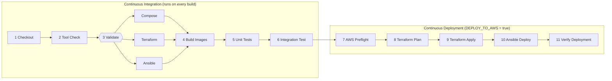

# CivicHelp CI/CD Pipeline

One Jenkins job, **`CivicHelp-Pipeline`**, takes a commit from GitHub to the running AWS server.
The pipeline is defined in [`Jenkinsfile`](../Jenkinsfile) at the root of the repository. Jenkins reads it from GitHub on every
run ("pipeline as code"), so the pipeline is versioned together with the application.

A stage only runs if every stage before it passed. A failing test therefore **stops the pipeline before anything
touches AWS**.

---

## 1. The stages

### CI: is this commit good?

| # | Stage | What it does | Why it is there |
|---|---|---|---|
| 1 | **Checkout** | `checkout scm` clones the commit from GitHub and stores its SHA in `DEPLOY_COMMIT`. The build description shows it, for example `commit 5e25ed6 -> AWS`. | Everything later refers to this exact commit. If someone pushes during the build, the pipeline still deploys what it tested. |
| 2 | **Tool Check** | Prints the versions of Docker, Compose, Terraform, Git, Ansible (in WSL) and the AWS CLI. | Fails fast with a clear message when the agent is missing a tool, instead of failing deep inside a later stage. |
| 3 | **Validate** (3 branches in parallel) | **Compose:** `docker compose config -q` on both compose files. **Terraform:** `fmt -check`, `init -backend=false`, `validate`. **Ansible:** `ansible-playbook --syntax-check`, `bash -n run-deploy.sh`. | Configuration is code and can be broken like code. The three checks are independent, so they run in parallel. `-backend=false` means validation never reads or locks the real Terraform state. |
| 4 | **Build Images** | `docker build` for the backend and frontend images, tagged `build-<N>` and `ci`. The React app is compiled inside the frontend image (multi-stage build). | Produces the artefacts the next stages test. The build-number tag makes every build traceable. |
| 5 | **Unit Tests** | Runs the backend tests (`node:test`, 12 tests) **inside the image that was just built**, then `nginx -t` and a check for `index.html` inside the frontend image. | Tests run on the same Node version and dependencies as production. No Node.js installation is needed on the Jenkins agent. |
| 6 | **Integration Test** | Starts the just-built images as a **throwaway stack** ([`docker-compose.ci.yml`](../docker-compose.ci.yml)) and runs [`tests/integration/workflow.test.js`](../tests/integration/workflow.test.js) (49 checks) through Nginx. The `post { always }` block removes the stack. | Unit tests cannot prove that Nginx, Express, MySQL and Socket.IO work *together*. This stage runs the complete citizen → officer → worker → citizen workflow before any deployment. |

**Why the integration test can never damage real data:** the throwaway stack keeps MySQL in memory (`tmpfs`), has
no named volumes, publishes no host ports and has its own Compose project name (`civichelp-ci`). It cannot see the
real `mysql-data` / `uploads-data` volumes and does not clash with a CivicHelp stack running on the same PC.

What the integration test covers:
- the health check (API **and** database);
- the Nginx security headers and the client-side route fallback;
- JSON 404 and 400 responses;
- registration, login, wrong password, invalid token, and role escalation being blocked;
- a complaint with a real PNG, a fake image rejected, and bad coordinates rejected;
- the permission matrix for all three roles;
- assignment, resolution with photo proof, reopening with a reason, re-resolution and confirmation;
- **real-time Socket.IO events through Nginx**, using a small long-polling client written into the test.

### CD: deliver it safely to the existing server

The CD stages run only when the `DEPLOY_TO_AWS` parameter is ticked (the default). Unticked, they show as *skipped*
in the stage view. This is still the same job and the same pipeline, which is useful when the AWS Academy lab is not started.

| # | Stage | What it does | Why it is there |
|---|---|---|---|
| 7 | **AWS Preflight** | `aws sts get-caller-identity` (are the Learner Lab credentials valid?), then finds `civichelp-server` and requires it to be `running`. It then **takes a snapshot of the live data**: every complaint id and photo URL from `GET /api/complaints`. | AWS Academy credentials expire every session, and this gives a clear message instead of a cryptic Terraform error. The snapshot is compared after the deployment in stage 11. |
| 8 | **Terraform Plan** | First checks that the Terraform files in `TF_DIR` (where the state lives) are identical to the files in the commit under test. Then runs `terraform plan -out=civichelp.tfplan` against the **existing state**. **Guard:** the build fails if the plan says `must be replaced` or anything other than `0 to add, N to change, 0 to destroy`. | The pipeline may update the security group in place (for example when your IP changes), but it can never create a second server or destroy the existing one with its data. |
| 9 | **Terraform Apply** | `terraform apply civichelp.tfplan` applies *exactly* the plan that passed the guard, then reads `ec2_public_ip`. | Applying a saved plan means nothing different from what was checked can be applied. Usually `0 added, 0 changed, 0 destroyed`. |
| 10 | **Ansible Deploy** | Runs [`ansible/run-deploy.sh`](../ansible/run-deploy.sh) inside WSL, which runs [`ansible/deploy.yml`](../ansible/deploy.yml). The server checks out **the commit under test** (`git_commit`), writes `.env` (mode `0600`, `no_log`) including `APP_VERSION`, runs `docker compose up --build -d`, waits for MySQL `healthy` and for `/api/health` to report `database: connected`, then prunes dangling images. | Ansible is idempotent: running it twice is safe. There is no `docker compose down` and never `-v`, so only changed containers are recreated, downtime is seconds, and the volumes are untouched. |
| 11 | **Verify Deployment** | **[1/5]** `/api/health` reports the database connected. **[2/5]** health reports `version` = the tested commit. **[3/5]** `/api/complaints` returns a JSON array (a real MySQL query). **[4/5]** the page contains `<title>CivicHelp` and `id="root"`. **[5/5]** every complaint id from the snapshot still exists and every photo URL still downloads. | Proves the *new* version is live (not an old container that happens to answer) and that **existing user data and photos survived** the deployment. Any failure fails the build. |

### Secrets

`CIVICHELP_DB_PASSWORD` and `CIVICHELP_JWT_SECRET` are Jenkins **Secret text** credentials. `withCredentials` exposes
them to one stage only, as environment variables. They are passed into WSL with `WSLENV` and never appear on a command line,
and Jenkins masks them as `****` in the log. On the server, Ansible writes them into `.env` with `no_log: true`. No
secret, AWS key, private key or Terraform state is in Git.

---

## 2. How Jenkins is set up

- Jenkins is the existing coursework installation (`D:\cloud-devops-assignment\vle-pbl3`), bound to `127.0.0.1:8080`,
  with security enabled.
- [`scripts/start-jenkins.ps1`](../scripts/start-jenkins.ps1) starts it with the tools on `PATH` (Git-for-Windows `sh`,
  Docker, Terraform, AWS CLI) and installs [`jenkins/init/civichelp-setup.groovy`](../jenkins/init/civichelp-setup.groovy).
- That init script runs inside Jenkins at start-up, so it needs no admin password:
  - creates or updates the two secret credentials from `D:\AWSConfig\civichelp-deploy.env`;
  - creates the `CivicHelp-Pipeline` job (pipeline from SCM: GitHub `main`, script path `Jenkinsfile`);
  - **retires** the old two-job setup (`CivicHelp-CI`, `CivicHelp-Deploy-AWS`) by **disabling** them. This happens only
    after `CivicHelp-Pipeline` has a successful build that deployed to AWS. Their history is kept as evidence.
- Ansible cannot run on Windows, so the Windows agent runs it inside **WSL Ubuntu**. On a Linux agent the same
  `run-deploy.sh` would run directly.

## 3. Parameters

| Parameter | Default | Meaning |
|---|---|---|
| `DEPLOY_TO_AWS` | ticked | Run stages 7-11. Untick for CI only |
| `TF_DIR` | `D:/CivicHelp/terraform` | Folder holding the **existing** `terraform.tfstate` and `terraform.tfvars` |
| `SSH_PRIVATE_KEY_PATH` | `D:/AWSConfig/civichelp-key` | Key for Ansible's SSH connection |
| `ADMIN_CIDR` | empty | SSH source for the security group. Empty means this PC's current public IP `/32`. `0.0.0.0/0` is rejected |

## 4. Running it

| How | Command / click |
|---|---|
| In the browser (normal) | http://localhost:8080 > **CivicHelp-Pipeline** > **Build with Parameters** > **Build** |
| Without logging in | `.\scripts\stop-jenkins.ps1` then `.\scripts\start-jenkins.ps1 -RunBuild Pipeline` (or `-RunBuild PipelineCIOnly`) |
| Read the result in the terminal | `.\scripts\status-jenkins.ps1 -ShowLog CivicHelp-Pipeline -Tail 80` |

Duration: about 2 minutes for CI only and about 7 minutes with the deployment. The server builds the React app on a 1 GB
t3.micro, which is the slowest part.

## 5. Questions you may be asked

**Why one pipeline and not separate CI and CD jobs?**
CD should only ever deploy something CI has just verified. In one pipeline this is guaranteed by stage order: a failed
test makes deployment impossible, and the deployed commit is the tested commit. The `DEPLOY_TO_AWS` parameter keeps the
"CI only" option without a second job.

**Is this Continuous Delivery or Continuous Deployment?**
With `DEPLOY_TO_AWS` ticked by default, a successful run deploys automatically, which is continuous deployment. The
pipeline is started manually (or by `-RunBuild`) rather than by a GitHub webhook. A webhook would need Jenkins to be
reachable from the internet, and here it deliberately listens only on `127.0.0.1`.

**Where are the images built for production?**
CI builds and tests the images on the Jenkins machine. The server rebuilds the **same commit** from source with
`docker compose up --build`, because there is no container registry. Docker Hub or ECR would be the next step:
push `build-<N>` in CI and pull it on the server, so the exact tested image bytes are deployed. The version check in
stage 11 proves the server runs the tested commit.

**How do you avoid destroying the server or the data?**
- Terraform runs against the one existing state.
- The plan guard refuses any add, replace or destroy.
- `lifecycle { ignore_changes = [ami] }` stops a new Ubuntu image from forcing a replacement.
- Ansible never runs `docker compose down -v`.
- Stage 11 proves that the existing complaints and photos are still there.

**What happens if the AWS lab is not started?**
Stage 7 fails after a few seconds with "AWS credentials are missing or expired" and the fix to run. CI results are still
visible, because stages 1-6 already passed.

**How is the database schema managed?**
`init.sql` creates the schema when the `mysql-data` volume is first created. Later changes are SQL files in
`migrations/`. This version needed no schema change, so existing data is untouched.

**Why does the integration test use a hand-written Socket.IO client?**
It keeps the test free of dependencies. It runs inside the backend image, which has no `socket.io-client`. Engine.IO
long-polling is plain HTTP, and the test performs the handshake, joins the namespace and reads the pushed events.
That proves the real-time path through Nginx.

**What would you improve next?**
- a container registry with image promotion;
- HTTPS (domain plus Let's Encrypt);
- a GitHub webhook through a reverse proxy;
- scheduled `mysqldump` backups to S3;
- frontend component tests.
